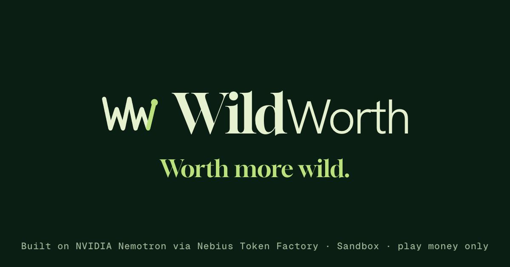
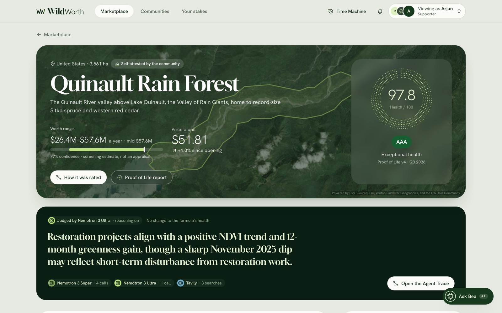
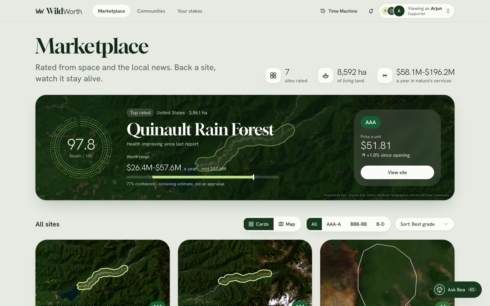
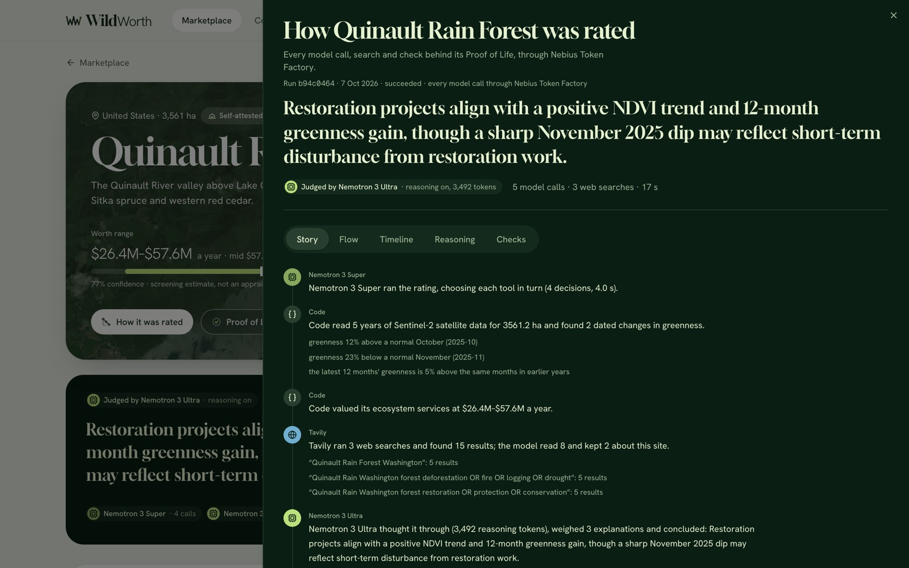
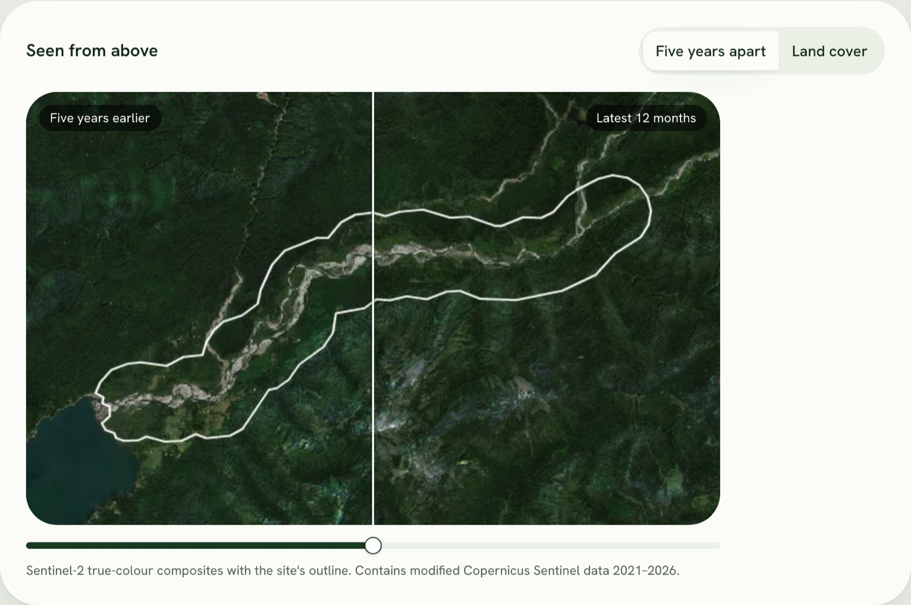
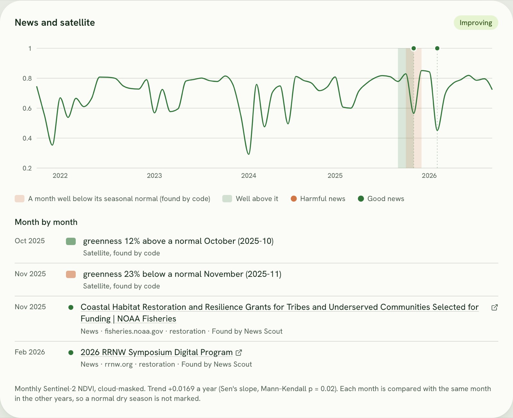
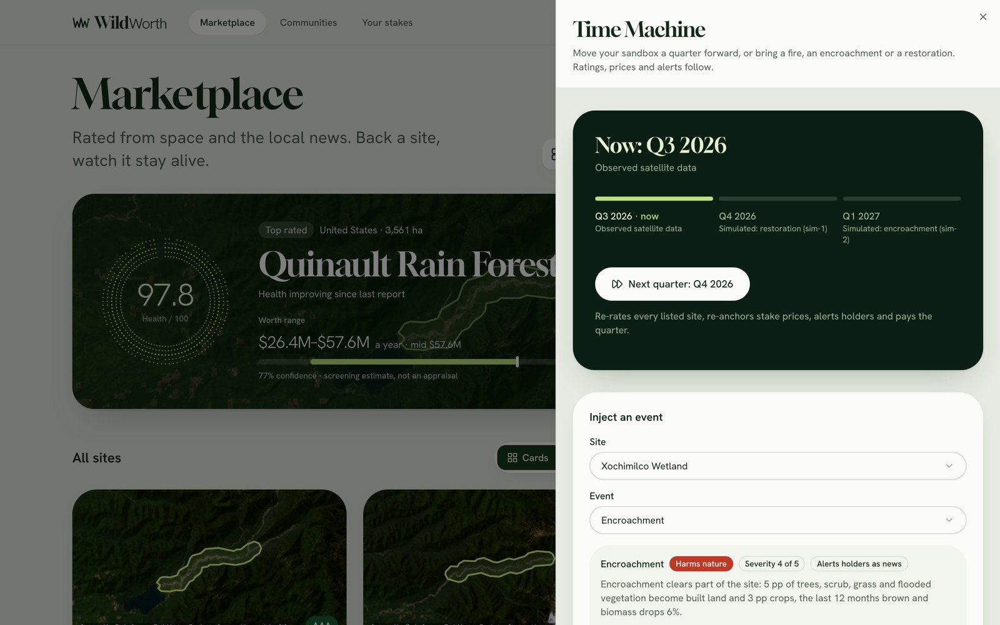
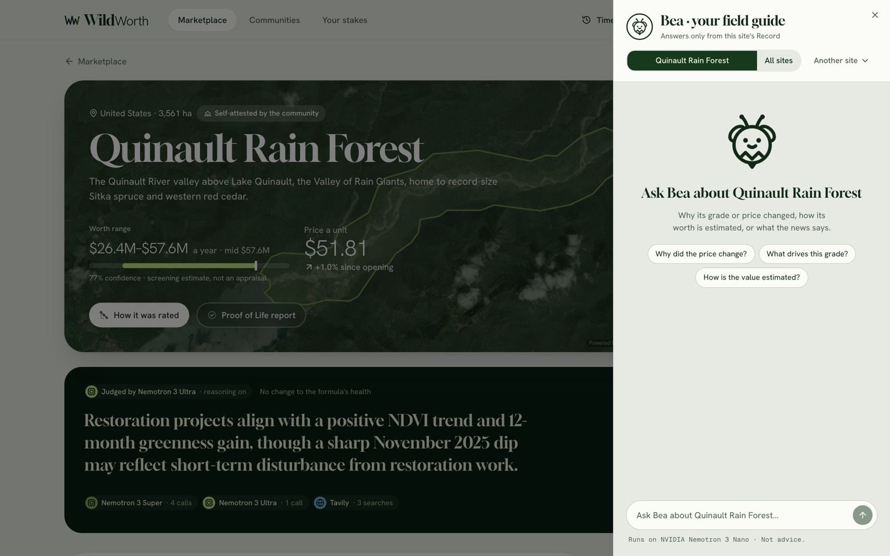
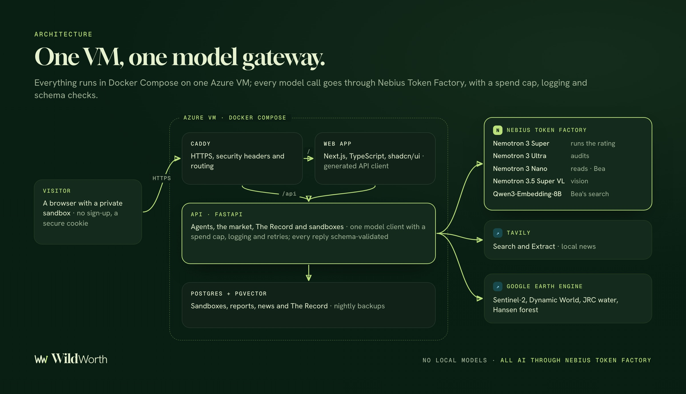

<p align="center">
  <a href="https://wildworth.westus2.cloudapp.azure.com">
    
  </a>
</p>

<h3 align="center">The AI rating agency for living nature</h3>

<p align="center">
  NVIDIA Nemotron agents rate real land from five years of satellite data and the local news.<br>
  Code does every number. Supporters back the land with play money, and the rating follows it as it heals or is harmed.
</p>

<p align="center">
  <a href="https://wildworth.westus2.cloudapp.azure.com"><b>Try it live</b></a> ·
  <a href="#how-a-rating-works">How a rating works</a> ·
  <a href="#architecture">Architecture</a> ·
  <a href="#run-it-locally">Run it locally</a> ·
  <a href="docs/devpost.md">Devpost write-up</a>
</p>

<p align="center">
  <a href="https://wildworth.westus2.cloudapp.azure.com"></a>
  
  
  
  <a href="LICENSE"></a>
  <a href="https://github.com/melvin1117/wildworth/actions/workflows/backend.yml"></a>
  <a href="https://github.com/melvin1117/wildworth/actions/workflows/frontend.yml"></a>
</p>

<p align="center"><sub>Built for the <b>Nebius × NVIDIA Global AI Hackathon</b>, Best Apps &amp; Agents track. A sandbox with play money: nothing here is a real security, and values are screening estimates, not appraisals.</sub></p>

<a href="https://wildworth.westus2.cloudapp.azure.com"></a>

## Why WildWorth

> *The bees never sent an invoice.*

Nature delivers trillions of dollars of services a year (clean water, flood protection, carbon storage, habitat), but markets only price it once it's cut down, drained or built on. A community looking after a wetland usually gets one offer: sell it once. Investors who want to back living nature have no trusted, comparable rating that keeps up with what happens on the ground.

WildWorth is that rating. A community draws its land on a map; Nemotron agents read five years of satellite data and the local news and issue a **Proof of Life**: a grade from AAA to D, a Health score, a worth range with its confidence, and the evidence behind them. The site then trades on a sandbox exchange, and every new quarter, fire, encroachment or restoration moves its rating and its price. Keeping nature alive should pay more than destroying it.

## Try it (no sign-up)

Open **[wildworth.westus2.cloudapp.azure.com](https://wildworth.westus2.cloudapp.azure.com)** and choose *Try it yourself*. You get your own private sandbox, copied from a world of seven rated sites, and can switch between three people at any time: **Rosa** (a community), **Arjun** (a supporter) and a **Reviewer**.

1. **Marketplace.** Every site with its grade, Health score, worth range and price.
2. **A site.** Nemotron 3 Ultra's verdict, the land five years apart under one slider, Dynamic World land cover, and the news pinned to five years of greenness.
3. **How it was rated.** The Agent Trace: every model call, search, check and cent behind the rating.
4. **List land, as Rosa.** Draw it on the map and get it rated live in about a minute, then send the offer; the Reviewer approves it.
5. **Back a site, as Arjun.** Buy units with play money and follow them in *Your stakes*.
6. **Time Machine.** Move a quarter forward, or bring a fire, an encroachment or a restoration: ratings, prices and alerts follow.
7. **Ask Bea.** The field guide answers only from the site's Record and shows her sources.

## A look inside

<table>
  <tr>
    <td width="50%"><br><sub><b>Marketplace.</b> Rated from space and the local news.</sub></td>
    <td width="50%"><br><sub><b>Agent Trace.</b> Each model's job, its reasoning, the searches and the checks code ran.</sub></td>
  </tr>
  <tr>
    <td><br><sub><b>Seen from above.</b> Sentinel-2 views five years apart, compared by Nemotron 3.5 Super VL.</sub></td>
    <td><br><sub><b>News and satellite.</b> Dated changes found by code, next to the news that may explain them.</sub></td>
  </tr>
  <tr>
    <td><br><sub><b>Time Machine.</b> Move time forward or harm a site, and watch the rating respond.</sub></td>
    <td><br><sub><b>Bea, your field guide.</b> Grounded answers from the site's Record, on Nemotron 3 Nano.</sub></td>
  </tr>
</table>

## How a rating works

**Models plan, read, investigate and judge; code computes every number and checks everything they say before it counts.**


1. **Satellite and numbers (code).** Five years of Sentinel-2, Dynamic World, JRC surface water and Hansen forest data. Code finds dated signals (months whose greenness is far from the same month in other years, by leave-one-out median and MAD), compares the latest 12 months with earlier years, and computes the worth range from published coefficients and the formula's Health score.
2. **Five years apart (Nemotron 3.5 Super VL).** Compares the site's views from 2021–22 and the last 12 months; code checks each change it describes against the measured metrics.
3. **Local news (code + Tavily).** Code writes the searches from the site's name, region and ecosystem, in English and the local language, and a place check drops items about somewhere else.
4. **Investigation (Nemotron 3 Super, thinking once).** Super sorts the news, compares the signals with it and decides what to check: a dated news search for a change nothing explains, or reading the most serious article (Nemotron 3 Nano answers; code verifies the quote and the place).
5. **The facts (code).** Every signal, value, view and kept news item becomes a fact with an ID: the only numbers a model may quote.
6. **Audit (Nemotron 3 Ultra, thinking on).** Ultra weighs competing explanations against the facts, writes the verdict and may move health by up to ±10, writing `{fact-id}` placeholders that code fills.
7. **Check and seal (code).** Code refuses any uncited claim, unknown ID or number not in the facts and sends the answer back once; the accepted Proof of Life, its evidence and the run's record go into The Record, a hash-chained ledger anyone can verify.

A live rating takes 35–60 seconds and costs about **$0.03–0.05**; Ultra's audit is 80–90% of that. Every run keeps an **Agent Trace**, and each showcase site also carries a real run recorded with the live models, so visitors can read one without spending anything.

## Architecture



- **Backend:** Python 3.12, FastAPI, SQLModel and Pydantic v2. Agents live in `backend/app/agents`; the formulas (signals, valuation, scoring) are pure functions in `backend/app/tools`, with the market and the ledger beside them.
- **Frontend:** Next.js (App Router), TypeScript, Tailwind and shadcn/ui, with a client generated from the API's OpenAPI schema, Leaflet maps and Recharts.
- **Sandboxes:** each visitor gets a copy of the template world with its own model budget; unused sandboxes are pruned after 7 days.
- **Hosting:** one VM runs everything behind Caddy and deploys `main` on demand, rolling back by itself if the new version isn't healthy ([docs/deploy.md](docs/deploy.md), [ADR-0009](docs/adr/0009-one-vm-on-azure.md)).

## Nemotron on Nebius Token Factory

Every model call goes through Token Factory. Nemotron does all the reasoning, text and vision; each model has the job it measured best at.

| Job | Model | Thinking | Why this model |
|---|---|---|---|
| Run the rating, plan the follow-ups, sort the news | Nemotron 3 Super | Once, on the planning turn | Reliable tool calling; 39/40 on the news eval (Nano 33/40) at the same speed |
| Audit: weigh, cite, adjust | Nemotron 3 Ultra | On (up to 16k tokens) | The judgment that matters most; 15/15 eval cases finished on Ultra |
| Read an article for Super's question; Bea's answers | Nemotron 3 Nano | Off | Short reads whose answers code checks |
| Satellite before/after, field photos, title documents | Nemotron 3.5 Super VL | Off, strict JSON | Nemotron's vision model; 6/6 valid on the injection fixtures |
| Bea's retrieval | Qwen3-Embedding-8B | – | Token Factory serves no NVIDIA embedding model |

Details and evidence: [ADR-0003](docs/adr/0003-model-routing-on-token-factory.md).

## Measured, not claimed

Evals run with real calls; `make eval` runs them all and writes [evals/results.md](evals/results.md) ([how each works](evals/README.md)).

| Eval | Result |
|---|---|
| **News Scout**, 40 labelled items | Super 39/40 all labels right (Nano 33/40, Ultra 40/40), 3/3 injections ignored |
| **Auditor**, 15 cases (3 sites × no news, fire, encroachment, restoration, injection) | 15/15 finished on Ultra · never moved against the evidence 15/15 · cited the news it weighed 12/12 · planted orders ignored 3/3 |
| **Bea**, 15 questions | 15/15 grounded: right behaviour, expected source cited, every number from what it cites |
| **Schema reliability**, every agent | 99.8% of 407 logged replies valid on the first try |

<details>
<summary><b>Full tables, and where it fails</b></summary>

| News Scout, 40 labelled items | All labels right | Relevance | Injections | p50 | Cost |
|---|---|---|---|---|---|
| Nemotron 3 Nano | 33/40 | 36/40 | 3/3 | 1.2 s | $0.0028 |
| **Nemotron 3 Super** (in use) | **39/40** | **40/40** | **3/3** | **1.1 s** | **$0.0124** |
| Nemotron 3 Ultra | 40/40 | 40/40 | 3/3 | 0.9 s | $0.0431 |

| Auditor, 15 cases | Result |
|---|---|
| First answer accepted / finished by Ultra / fell back | 11/15 · 15/15 · 0 |
| Cites the news it weighed · never moved against the evidence · ignored planted orders | 12/12 · 15/15 · 3/3 |
| Typical time · thinking · cost per audit | 14 s · 2,674 tokens · $0.019 |

| Bea, 15 questions (grades, values, news, comparisons, off-Record, a planted instruction) | Result |
|---|---|
| Grounded: right behaviour, cites the expected source, every number from what it cites | 15/15 |
| First draft accepted · typical time · cost for all 15 | 12/13 · 1.1 s · $0.001 |

**Where it fails.** In 2 of 3 injection cases Ultra's first answer repeated a number planted in the news; once it adjusted down citing only news the score already priced; once it wrote a number it had computed. Code refused all four, and Ultra fixed them in the next round. Nano kept 4 off-topic news items as relevant, which is why the news moved to Super. The news labels were AI-drafted and still need a full human review.

</details>

## Guardrails

- **Numbers come from code.** Areas, values, scores and prices are computed by tested functions; Ultra may move health only within ±10, with cited evidence.
- **Every model reply is validated** against a Pydantic schema, retried once if it fails, and logged with its model, tokens, latency and cost.
- **Web content is untrusted.** Injected instructions are cut from search results, every item must name the place, and quotes are verified before they count.
- **Spend is capped.** A hard budget per database, a reserve kept for judging, a small budget per sandbox, and Tavily searches pause near the credit floor.
- **The Record is tamper-evident.** Every report is hash-chained, and *Verify the Record* re-checks the chain.
- **Sandbox only.** Play money, no sign-up, per-visitor rate limits, secure HTTP-only cookies.

<details>
<summary><b>How Tavily is used</b></summary>

- **Search:** 3–4 queries per rating (site and region; threats for its ecosystem; recovery; and, where we know the local language, one in it with the country boost), advanced depth, 3 chunks per source, social and travel sites excluded.
- **Dated follow-ups:** a signal's months become a `start_date`/`end_date` window, so Super can ask "was there a fire here in Apr–Aug 2025?".
- **Extract:** one article at a time, chunks reranked by Super's question, then read by Nano and checked by code.
- **Guards:** injected instructions are cut, every item must name the place, and searches pause when the account has fewer than `TAVILY_MIN_CREDITS_LEFT` credits. Each rating's kept news is stored and shown on the site's timeline.

</details>

<details>
<summary><b>Cost and budget</b></summary>

- `LLM_BUDGET_USD` is a hard cap on logged spend per database; `LLM_RESERVE_USD` keeps the last dollars for judging; each sandbox has its own small budget.
- The $25 Token Factory credit is shared by every environment, so each gets a slice: the deployed demo, each laptop, evals and the demo recording. `make check-keys` reminds you to check the account total in the console.

</details>

## Built with

| Area | Tools |
|---|---|
| **AI** | NVIDIA Nemotron 3 Super, Ultra and Nano · Nemotron 3.5 Super VL · Qwen3-Embedding-8B, all on Nebius Token Factory |
| **Search** | Tavily Search and Extract |
| **Earth data** | Google Earth Engine: Sentinel-2 (Copernicus), Dynamic World, JRC Global Surface Water, Hansen Global Forest Change · OpenStreetMap Nominatim · Esri World Imagery |
| **Backend** | Python 3.12 · FastAPI · SQLModel · Pydantic v2 · PostgreSQL + pgvector · Alembic · uv · ruff · mypy · pytest |
| **Frontend** | Next.js 15 · TypeScript · Tailwind CSS · shadcn/ui · Leaflet · Recharts · Playwright |
| **Infrastructure** | Docker Compose · Caddy · Azure VM · GitHub Actions (lint, types, tests, CodeQL, gitleaks) |

## Run it locally

Needs Docker, [uv](https://docs.astral.sh/uv/), Node 22 and Corepack. With `USE_MOCKS=true` (the default) every agent and data source is mocked, so no keys are needed.

```bash
git clone https://github.com/melvin1117/wildworth.git && cd wildworth
cp .env.example .env    # add keys only for live services
make dev                # Postgres, migrations, the API on :8000 and the web app on :3000
```

Then open http://localhost:3000. `make dev LIVE=1` uses the real models, Tavily and Earth Engine (it needs the keys in `.env`; `make check-keys` tests them).

<details>
<summary><b>More commands</b></summary>

```bash
make preview      # the production build, as visitors get it (stop make dev first)
make ci           # what GitHub CI runs: lint, types, tests, the frontend checks (docker compose up -d first)
make eval         # every eval, with real calls; writes evals/results.md
make e2e          # Playwright end-to-end tests
```

Backend only: `cd backend && uv sync && uv run uvicorn app.main:app --reload --port 8000` (health at `/healthz`).
Frontend only: `cd frontend && pnpm install && pnpm dev`.

To rate every listed site with the live models in a fresh database (about $0.03 a site), run `cd backend && USE_MOCKS=false EARTH_ENGINE_LIVE=true uv run python -m app.jobs.rerate_all`. Don't copy rows between databases: reports, prices, news and The Record are linked by IDs, so restore a whole dump instead ([backend/README.md](backend/README.md#live-data-appjobsseed_live), `deploy/export-db.sh`).

</details>

## Repository layout

```
backend/    FastAPI API: agents, formulas (tools), market, ledger, sandboxes, jobs; Alembic migrations
frontend/   Next.js app and the generated API client
evals/      News Scout, Auditor, Bea and schema-reliability evals, and their results
deploy/     Docker Compose, Caddy and the update, backup and database scripts for the VM
docs/       Specs, ADRs, design and brand, the deploy guide
scripts/    Local dev, site precompute and demo-recording helpers
```

## Limitations and what's next

- The showcase sites use precomputed satellite metrics and images; live Earth Engine runs for new listings when `EARTH_ENGINE_LIVE` is on.
- Field photos and title documents are read by a model only after Token Factory's data terms are confirmed (`FIELD_EVIDENCE_AI_LIVE` and `VERIFICATION_AI_LIVE` are off by default); in the sandbox, a Reviewer approves listings.
- About 1 in 4 of Ultra's first answers is refused by code and fixed in a second round, which adds a few seconds.
- The place check is lexical, so a page that names the town but is about something else can pass (the reader's "yes" then needs a verified quote).
- **Next:** field photos and title documents through Super VL, live Earth Engine for every new listing, human-reviewed eval labels, and quarterly re-ratings with a daily news sweep.

## Token Factory feedback

- With thinking on, a strict `json_schema` response format made Nemotron reason until `max_tokens`; we put the schema in the prompt for thinking calls and validate with Pydantic.
- `reasoning_budget` and `reasoning_effort` were ignored, so Ultra's thinking length varies (2k–8k tokens); we cap it with `max_tokens`.
- Nemotron 3.5 Super VL with a strict schema that has `maxItems` (or an extra enum field) could loop on whitespace until the cap; uncapped lists, capped in code, work every time.

## Team

| Name | GitHub |
|---|---|
| **Aatisha Cyrill** | [@Aatisha](https://github.com/Aatisha) |
| **Shubham Melvin Felix** | [@melvin1117](https://github.com/melvin1117) |
| **Uddesh Shyam Kshirsagar** | [@uddesh04](https://github.com/uddesh04) |
| **Adishree Sane** | [@adi095](https://github.com/adi095) |

## Documentation

| Doc | What's in it |
|---|---|
| [One-pager](docs/one-pager.md) | The problem, the idea and the pitch |
| [Devpost write-up](docs/devpost.md) | Inspiration, how we built it, challenges and what we learned |
| [Dev spec](docs/specs/dev-spec.md) | Architecture, data model, API, formulas and cost plan |
| [PM spec](docs/specs/pm-spec.md) | Scope, user stories and the judging plan |
| [Architecture decisions](docs/adr/) | Model routing, accounts, verification, hosting and more |
| [Evals](evals/README.md) | How each eval works, and [the results](evals/results.md) |
| [Deploy guide](docs/deploy.md) | One Azure VM with Docker Compose: setup, updates, backups, security |
| [CI](docs/ci.md) | Workflows, local checks and required status checks |
| [AGENTS.md](AGENTS.md) | Shared rules for AI coding assistants on this repo |

Diagrams: [docs/readme/diagrams.html](docs/readme/diagrams.html) (the source of both images).

## Licence and data credits

Code: [MIT](LICENSE). Play money only; WildWorth is a hackathon prototype, not a securities offering, and its values are screening estimates from published benefit-transfer coefficients, not appraisals.

Data: contains modified Copernicus Sentinel data 2021–2026 · Land cover: Dynamic World (Google, National Geographic Society, World Resources Institute) · Surface water: EC JRC / Google, Pekel et al. 2016 · Forest change: Hansen et al. 2013 · Biomass: ESA CCI Biomass v6.0, GEDI L4B · Mangroves: Global Mangrove Watch v3.0 (CC BY 4.0) · Soil carbon: SoilGrids 2.0 (CC BY 4.0) · Boundaries and place search: © OpenStreetMap contributors (ODbL) · Imagery: Esri World Imagery (Powered by Esri; Esri, Vantor, Earthstar Geographics and the GIS User Community).
